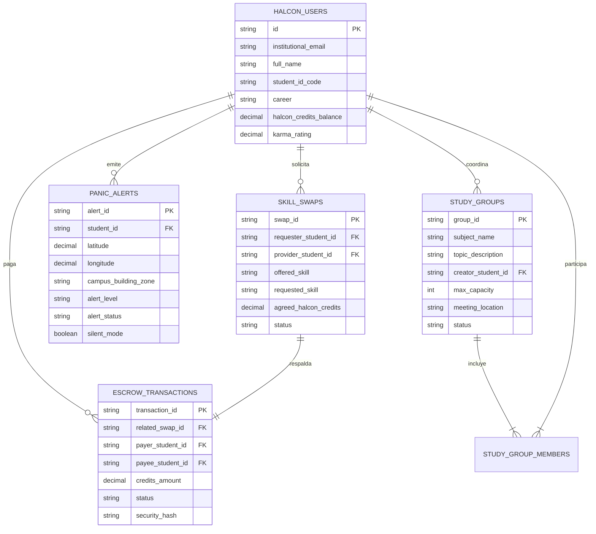

# Modelo de Datos Halcón - Nexus-Tec (ITTOL)

Diagrama Entidad-Relación y especificaciones de la base de datos relacional para el ecosistema Nexus-Tec en el Instituto Tecnológico de Toluca (TecNM).

---

## 📊 Diagrama Entidad-Relación (ERD)

