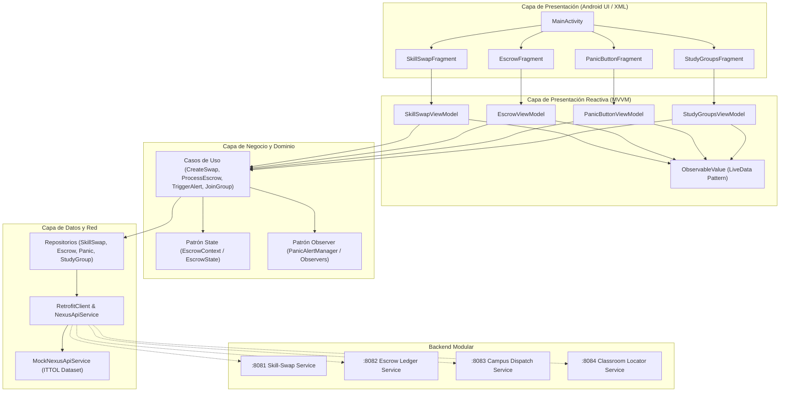
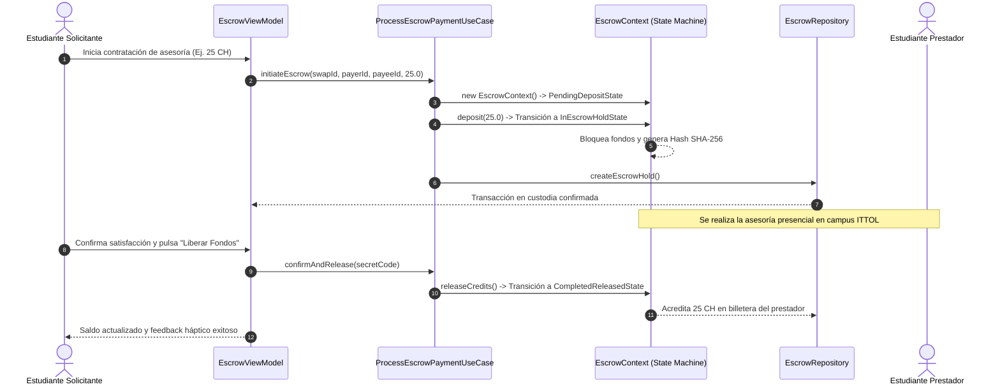
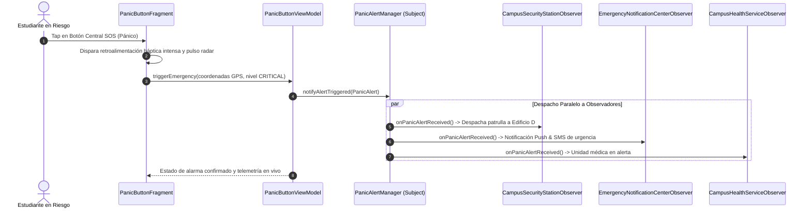

# Arquitectura de Software Nexus-Tec - ITTOL (TecNM)

Documento de especificación arquitectónica para el ecosistema móvil y modular de **Nexus-Tec**, desarrollado para la comunidad estudiantil de los **Halcones del Instituto Tecnológico de Toluca**.

---

## 🏛️ 1. Diagrama de Capas (Clean Architecture + MVVM)

---

## 🔄 2. Diagrama de Secuencia: Ciclo de Vida Escrow (Patrón State)

---

## 🚨 3. Diagrama de Secuencia: Botón de Pánico (Patrón Observer)

